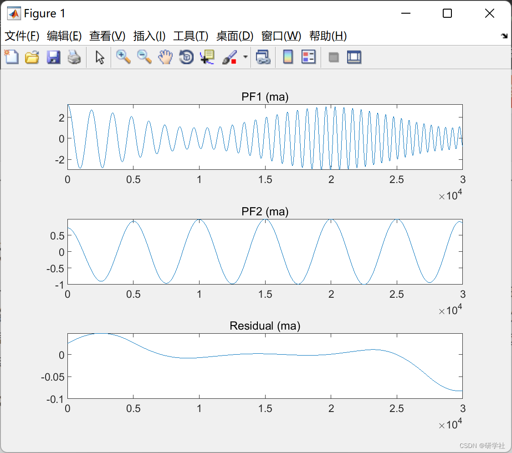
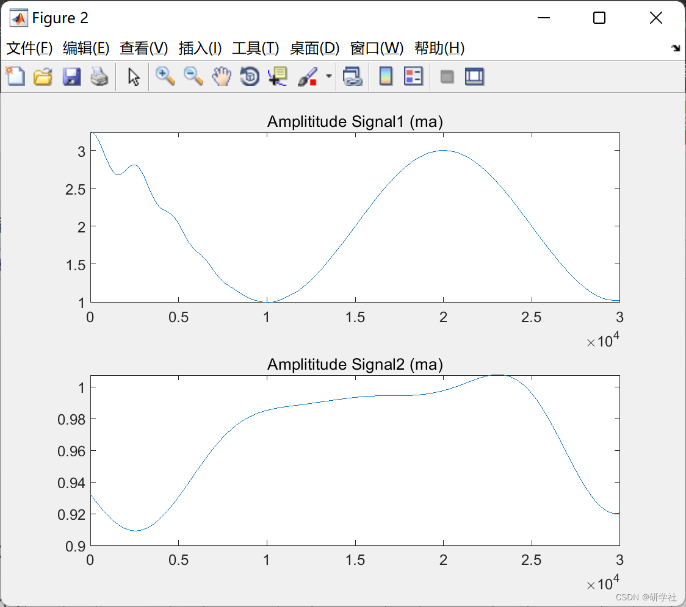
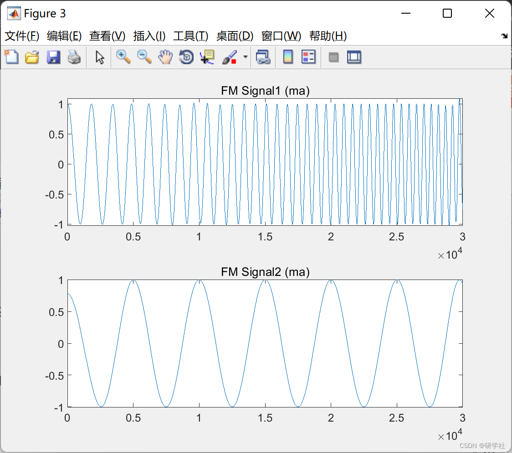
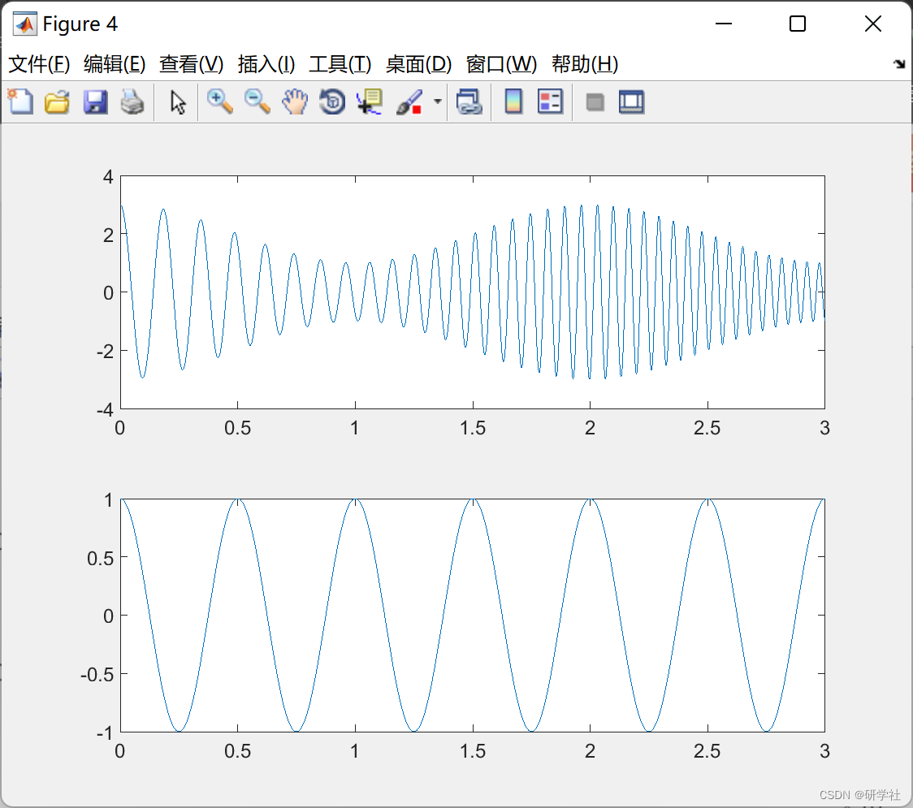

# Robust Local Mean Decomposition (RLMD) (Matlab code implementation)

📚2 Running Results Editing
Edit
Edit
Edit
Edit
Part of the code:
[x, display, stop_thre, sifting_stopping_mode, max_iter, max_pfs, smooth_mode,...
ma_span, ma_iter_mode, extd_r, x_energy, pfs, ams, fms, iterNum, fvs]...  
= initial(x,varargin{:});  
% Initialize main loop  
i = 0;  
xs = x; % copy x to xs for sifting process, reserve original input as x.  
nx = length(x);  
while i < max_pfs && ~stoplmd(xs, x_energy) % outer loop for PF selection  
i = i+1;  
% initialize variables used in PF sifting loop  
a_i = ones(1,nx);  
s_j = zeros(max_iter,nx);  
a_ij = zeros(max_iter, nx);  
% PF sifting iteration loop  
j = 0;  
stop_sifting = 0;  
s = xs;
while j < max_iter && ~stop_sifting % inner loop for sifting process  
j = j+1;  
[m_j, a_j, n_extr] = lmd_mean_amp(s, smooth_mode, ma_span, ma_iter_mode,...  
extd_r);  
% force to stop iter if number of extrema of s is smaller than 3.  
if n_extr < 3  
break;  
end  
h_j = s-m_j; % remove mean.  
s = h_j./a_j; % demodulate amplitude.  
a_i = a_i .* a_j; % mulitiply every ai  
a_ij(j, :) = a_i;  
s_j(j, :) = s;  
[stop_sifting,fvs(i,:)] = is_sifting_stopping(a_j, j, fvs(i,:), sifting_stopping_mode, stop_thre);  
end % sift iteration loop  
switch sifting_stopping_mode  
case {'liu'}  
[~, opt0] = min(fvs(i,1:j)); % ***Critical Step***  
opt_IterNum = min(j, opt0); % in case iteration stop for n_extr<3  
%      opt_IterNum = min(j-2, opt0);  
otherwise  
error('No specifications for sifting_stopping_mode.');  
end  
ams(i, :) = a_ij(opt_IterNum, :); % save each amplitude modulation function in ams.  
fms(i, :) = s_j(opt_IterNum, :); % save each pure frequency modulation function in fms.  
pfs(i, :) = ams(i, :).*fms(i, :); % gain Product Funcion.  
xs = xs-pfs(i, :); % remove PF just obtained from input signal;  
iterNum(i) = opt_IterNum; % record the iteration times taken by of each PF sifing.  
end % main loop  
pfs(i+1, :) = xs; % save residual in the last row of PFs matrix.  
ams(i+1:end,:) = []; fms(i+1:end,:) = []; pfs(i+2:end,:) = []; fvs(i+1:end,:) = [];  
ort = io(x, pfs);  
% Output visualization  
if display == 1  
lmdplot(pfs, ams, fms, smooth_mode);  
end  
end  
%--------------------------- built-in functions ---------------------------  
% initialize signal and options  
function [x, display, stop_thre, sifting_stopping_mode, max_iter, max_pfs, smooth_mode,...  
ma_span, ma_iter_mode, extd_r, x_energy, pfs, ams, fms, iterNum, fvs]...  
= initial(x,varargin)  
% option fields(i.e. name)  
optn_fields = {'display', 'stop_thre', 'sifting_stopping_mode', 'max_iter',...  
'max_pfs', 'smooth_mode', 'ma_span', 'ma_iter_mode','extd_r', 'fix','fix_h'};  
🎉4 References
[2] Smith J S. The local mean decomposition and its application to EEG perception data[J]. Journal of the Royal Society Interface, 2005, 2(5): 443-454.  
[3] G. Rilling, P. Flandrin and P. Goncalves. On empirical mode decomposition and its algorithms. IEEE-EURASIP Workshop on Nonlinear Signal and Image Processing NSIP-03, Grado (I), June 2003  
🌈4 MATLAB code implementation

## Images

<!-- PAYMENT_BLOCK -->

## Get this dataset

- Payment link (Stripe): [Buy now](https://buy.stripe.com/3cs8yP7sY87d0vu9AB)
- Payment QR code: 

<!-- /PAYMENT_BLOCK -->
